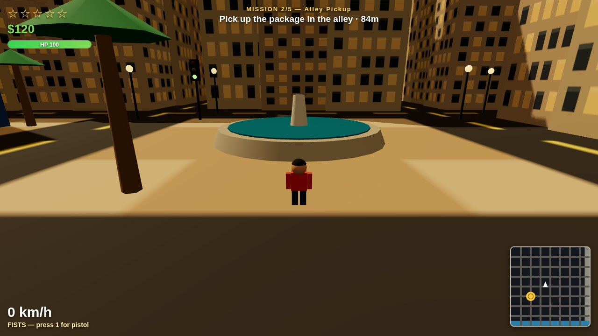
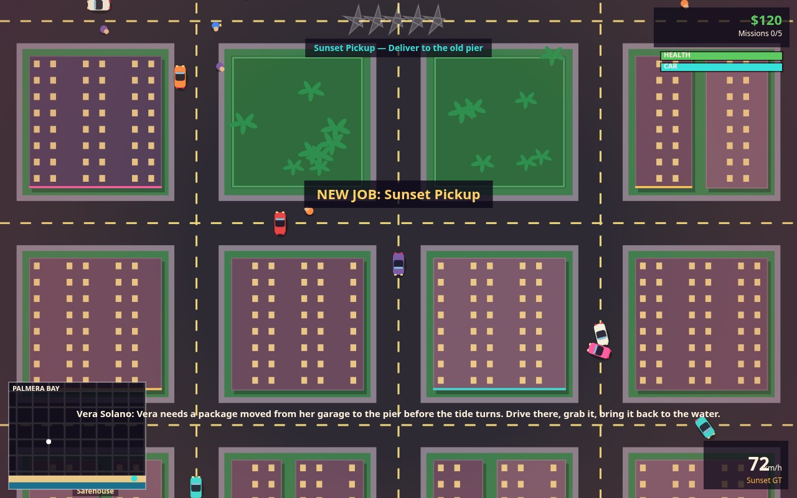
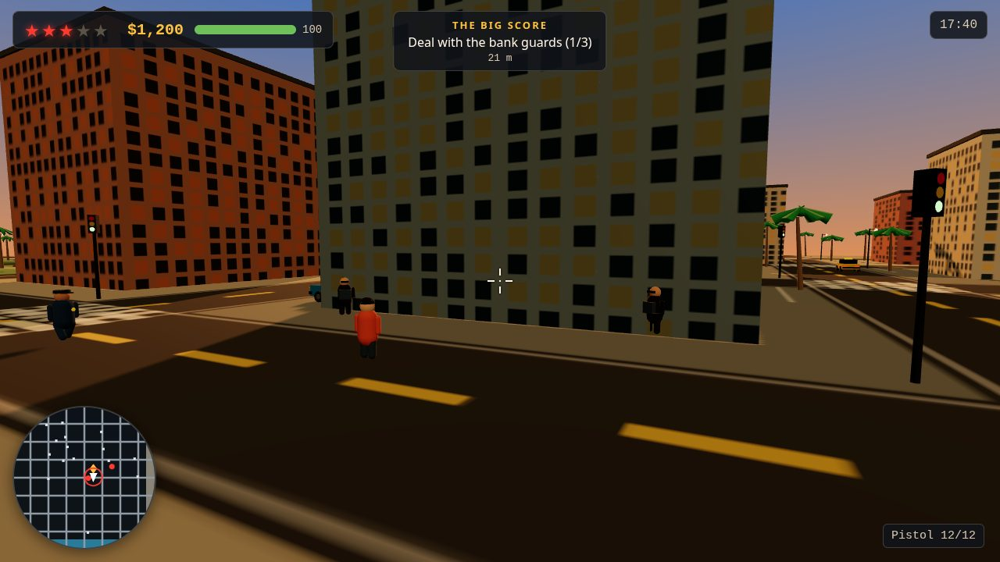

[](https://make.fun/bounty/gta6-01?utm_source=github&utm_medium=readme&utm_campaign=gta6-01)
[](https://make.fun/bounty/gta6-01/leaderboard?utm_source=github&utm_medium=readme&utm_campaign=gta6-01)
[](https://make.fun/bounty/gta6-01?utm_source=github&utm_medium=readme&utm_campaign=gta6-01)

# Palmera Bay: Sunset Heat

A top-down open-city crime game set in Palmera Bay, a sun-baked coastal city where the streets never cool down. Steal cars, outrun the police, run missions for the crew, and build your reputation — one sunset at a time.

You play a small-time hustler trying to make a name in Palmera Bay. Take jobs from fixers, grab whatever wheels you can find, and keep the heat off your tail. The city is alive: traffic flows, pedestrians scatter, sirens close in, and every choice raises or lowers your wanted level.






## How to run it

No build step, no dependencies to install. The game runs entirely in the browser.

**Option 1 — dev server (recommended):**

```bash
bun serve.ts
```

Then open the URL printed in the terminal (http://localhost:3000 by default).

**Option 2 — any static file server:**

```bash
cd game
python3 -m http.server 8000
```

Then open http://localhost:8000 in your browser.

**Option 3 — open the file directly:**

Open `game/index.html` in a modern browser (Chrome, Firefox, Safari, or Edge). Audio starts after your first click or key press, as browsers require.

## Controls

| Key | Action |
| --- | --- |
| W / A / S / D or Arrow keys | Move on foot / drive |
| Shift | Sprint on foot |
| E | Enter / exit a vehicle |
| Mouse | Aim |
| Left click | Shoot (on foot) |
| Space | Handbrake while driving |
| R | Reload |
| M | Mute / unmute audio |
| P or Esc | Pause |
| Enter | Confirm / advance dialogue |

On mobile, on-screen touch controls appear automatically: a joystick to move and drive, and buttons to enter vehicles, shoot, and brake.

## Features

- **Open city** — a hand-built map of Palmera Bay: downtown streets, the beachfront boulevard, back alleys, parking lots, and the pier. Day fades into a long orange sunset as you play.
- **Driving** — steal any parked or moving car, each with its own speed, handling, and durability. Traffic reacts to you, and crashes leave dents, smoke, and sparks.
- **Police & wanted system** — cause trouble and the heat rises, from a single patrol car up to roadblocks and a full pursuit. Break line of sight, ditch the car, or lay low until the stars cool off.
- **Missions** — a chain of story jobs from the crew: getaways, deliveries, pickups, and hits, plus repeatable side gigs around the city. Finish a mission to earn cash and unlock the next one.
- **Pedestrians** — crowds that stroll, cross streets, panic, and flee when shots are fired or cars mount the sidewalk.
- **HUD** — health, armor, cash, wanted stars, mission tracker, and a live minimap showing missions, cars, and police.
- **Audio** — procedural engine hums, sirens, gunfire, footsteps, and a sunset radio vibe, all generated in code with no audio files.
- **Save system** — progress, cash, unlocked missions, and best stats are saved automatically to your browser. Pick up right where you left off.

## Tips

- A stolen car is a disguise: swapping vehicles is the fastest way to drop a wanted level.
- Pedestrians remember chaos — keep it quiet near a mission pickup and the police stay away.
- The beachfront is the fastest escape route out of downtown, but the pier is a dead end.
- Completing side gigs between story missions is the easiest way to afford repairs and armor.

## Project structure

```
.
├── README.md
├── LICENSE
├── main.ts            # Entry point used by the make.fun harness
├── serve.ts           # Local dev server
├── shots.json         # Screenshot manifest
├── game/
│   ├── index.html     # Game page
│   ├── style.css      # UI and HUD styling
│   ├── src/
│   │   ├── main.js        # Game loop and bootstrapping
│   │   ├── config.js      # Tuning, balance, and constants
│   │   ├── city.js        # Map, streets, buildings, and props
│   │   ├── player.js      # On-foot movement and actions
│   │   ├── vehicles.js    # Cars, traffic, and driving physics
│   │   ├── police.js      # Wanted levels, pursuit, and roadblocks
│   │   ├── pedestrians.js # Crowd AI
│   │   ├── missions.js    # Story missions and side gigs
│   │   ├── hud.js         # HUD, minimap, and menus
│   │   ├── audio.js       # Procedural sound and music
│   │   ├── effects.js     # Particles, smoke, and screen shake
│   │   ├── save.js        # Autosave and load
│   │   ├── shots.js       # Screenshot capture helpers
│   │   └── random.js      # Seeded random helpers
│   └── vendor/
│       └── three/         # Vendored Three.js
├── screenshots/       # Cover, street, mission, and combat shots
├── vendor/
│   └── makefun-game.ts
└── out/               # Build output (generated)
```

## Tech

- Plain JavaScript and HTML5 Canvas — no game engine, no framework.
- Three.js (vendored) for 3D flourishes.
- TypeScript entry (`main.ts`) and dev server (`serve.ts`) for the make.fun harness.
- Everything runs client-side; your save never leaves your browser.

## License

MIT — see [LICENSE](LICENSE).

---

Built for the [make.fun gta6-01 bounty](https://make.fun/bounty/gta6-01) — a GTA 6-inspired game jam. Palmera Bay is a fictional city; any resemblance to real places is purely coincidental.
