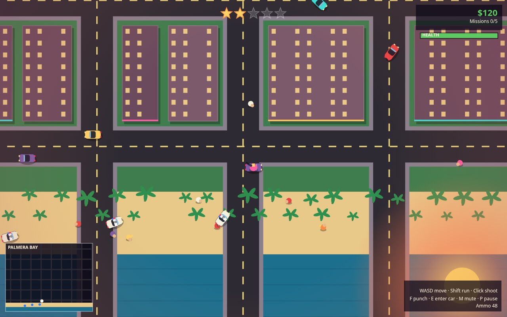

[](https://make.fun/bounty/gta6-01?utm_source=github&utm_medium=readme&utm_campaign=gta6-01)
[](https://make.fun/bounty/gta6-01/leaderboard?utm_source=github&utm_medium=readme&utm_campaign=gta6-01)
[](https://make.fun/bounty/gta6-01?utm_source=github&utm_medium=readme&utm_campaign=gta6-01)

# Palmera Bay: Sunset Heat

A top-down open-city crime game set in Palmera Bay, a sun-baked coastal city where every street is an opportunity and every siren is a warning. Steal cars, outrun the police, take on missions from the city's fixers, and build your reputation — one sunset at a time.



## What is it?

Palmera Bay: Sunset Heat is a 2D top-down open-world game inspired by classic GTA-style gameplay. You are free to roam the city on foot or behind the wheel: cruise the boulevards, grab any parked car, dodge traffic, and complete missions to earn cash and respect. The hotter your wanted level burns, the harder the Palmera Bay Police Department comes after you.

The game runs entirely in the browser — no install, no account, no build step.

## Features

- **Open city** — a living map of streets, intersections, beaches, and back alleys, all rendered top-down with a warm sunset palette.
- **Driving** — steal any car on the street, accelerate, brake, and drift around corners. Every vehicle handles differently, from beat-up sedans to fast sports cars.
- **On-foot action** — walk the sidewalks, run from trouble, and hop in and out of cars whenever you like.
- **Police & wanted system** — cause chaos and your wanted level climbs. Patrol cars give chase, roadblocks appear, and the heat only cools down when you lay low.
- **Missions** — pick up jobs from fixers around the city: getaways, deliveries, chases, and timed runs. Finish them to earn cash and unlock harder work.
- **Pedestrians & traffic** — the city is alive. Pedestrians stroll the sidewalks, traffic flows through the streets, and the world reacts to what you do.
- **HUD** — speed, cash, wanted stars, mission tracker, and a minimap keep you oriented at a glance.
- **Audio** — engine hums, sirens, and ambient city sounds with a mute toggle.
- **Save system** — your cash, progress, and unlocked missions are saved in the browser, so you can pick up right where you left off.

## How to run it

You need a local static server (the game loads assets with `fetch`, so opening the HTML file directly from disk will not work in most browsers).

### Option 1 — the included server

```sh
# From the repository root
deno run --allow-net --allow-read serve.ts
```

Then open <http://localhost:8000> in your browser.

### Option 2 — any static server

```sh
# Serve the game/ directory, for example with Python:
python3 -m http.server 8000 --directory game
```

Then open <http://localhost:8000> in your browser.

### Option 3 — build / typecheck

```sh
deno check main.ts
```

## Controls

| Key | Action |
| --- | --- |
| W / Up arrow | Accelerate / walk forward |
| S / Down arrow | Brake / reverse / walk back |
| A / D or Left / Right arrows | Steer / walk left / right |
| Space | Handbrake (in a car) |
| E | Enter / exit vehicle |
| F | Interact / accept mission |
| M | Mute / unmute audio |
| P or Esc | Pause |
| R | Restart current mission |

On-screen touch controls are shown on mobile devices.

## Tips

- Lay low after a job: wanted stars fade when the police lose sight of you.
- Faster cars make getaways easier — but they also attract more attention.
- Watch the minimap: mission markers, police, and your current objective are all shown there.
- Crashing into traffic raises your wanted level. Drive clean when you can afford to.

## Screenshots

| | |
| --- | --- |
|  |  |
|  | |

## Project structure

```text
.
├── main.ts            # Game entry point and bootstrap
├── serve.ts           # Local development server
├── game/
│   ├── index.html     # Game page shell
│   ├── style.css      # Game styling and HUD
│   ├── src/           # Game source (city, vehicles, police, missions, HUD, audio, save)
│   └── vendor/        # Bundled third-party code
├── vendor/
│   └── makefun-game.ts # make.fun game integration
├── screenshots/       # In-game screenshots
├── shots.json         # Screenshot metadata
├── out/               # Build / dossier output
└── LICENSE            # License
```

## Tech

- Written in TypeScript, rendered on HTML5 Canvas.
- No framework, no bundler, no runtime dependencies for the game itself.
- Save data is stored locally in the browser (`localStorage`).

## License

See [LICENSE](LICENSE).
